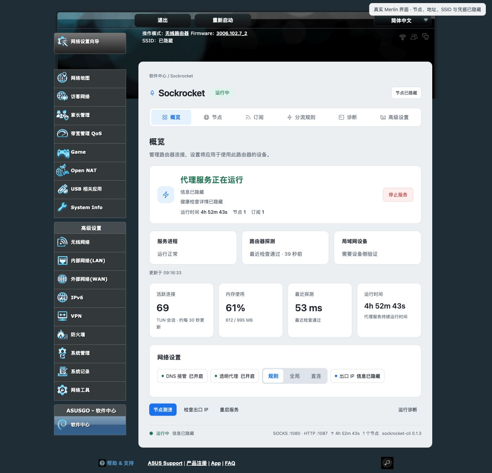

# Sockrocket

<p align="center">
  
</p>
<p align="center"><strong>One Rust proxy engine, from desktop to router.</strong></p>
<p align="center">Native desktop client · CLI · AsusWRT-Merlin plugin</p>
<p align="center"><strong>English</strong> · <a href="README.vi.md">Tiếng Việt</a> · <a href="README.zh.md">中文</a></p>
<p align="center">
  <a href="https://sockrockets.github.io/sockrocket/">Website</a> · <a href="https://t.me/sockrocket">Telegram · @sockrocket</a> ·
  <a href="https://github.com/sockrockets/sockrocket/releases/latest">Download</a> ·
  <a href="docs/getting-started.md">Get started</a> ·
  <a href="docs/routing.md">Routing</a> ·
  <a href="docs/merlin.md">Merlin guide</a> ·
  <a href="https://github.com/sockrockets/sockrocket/issues">Report a bug</a>
</p>

Sockrocket brings nodes, subscriptions, routing rules and traffic capture into one client. Its desktop interface follows the grouped layout of macOS System Settings; the CLI and Merlin plugin share the same Rust protocol engine.

> **About the images:** desktop illustrations follow the project's Figma direction and use synthetic data; released layouts may differ. The Merlin image is a sanitized capture of the actual management interface, with nodes, addresses, SSIDs and credentials hidden before export.


## What it does

| Capability | Purpose |
| --- | --- |
| Native protocols | Shadowsocks, VMess, VLESS, Trojan, TUIC, Hysteria2, AnyTLS and WireGuard |
| Nodes and subscriptions | Import node links or Clash / V2Ray / sing-box subscriptions; update, search, deduplicate and test latency |
| Routing | Rule, Global and Direct. An exit is the global node, one node, or a node group. See [Routing](docs/routing.md) |
| Traffic capture | System proxy for compatible apps; TUN for broader capture |
| Connections and traffic | Overview counts bytes since this process started. Subscriptions show the last three calendar months per node and per subscription |
| Shared engine | Desktop GUI, CLI and Merlin WebUI |
| Languages | English, Tiếng Việt and 中文 |

Protocol combinations have limits: ShadowTLS does not provide UDP; native VMess and WireGuard UDP have per-packet size limits. VLESS Vision supports TLS 1.3/REALITY over TCP and XUDP; the standard flow rejects UDP/443. gRPC/XHTTP are not implemented and fail explicitly. See the [protocol guide](docs/protocols.md). Sockrocket does not provide proxy nodes or subscription services.

## New protocols: AnyTLS and WireGuard

> **Version scope:** these capabilities describe the current source. Packages on GitHub Releases follow their respective release notes.

| Protocol | Capabilities | Current limits |
| --- | --- | --- |
| AnyTLS v2 | Native TLS, session reuse, TCP and UDP-over-TCP v2; share link, Clash and sing-box import | Certificates verified by default; UDP is carried over TCP |
| WireGuard | Native userspace TCP / UDP, preshared keys and tunnel DNS; single-peer profile, Clash and sing-box import | One peer per node; UDP must fit the MTU; no IP fragmentation or profile scripts |

Desktop, CLI and Merlin share these implementations and existing local configuration persistence. The WireGuard protocol path creates no additional OS interface and changes no system routes or DNS settings; application-level TUN capture is controlled separately. Both protocols have passed interoperability tests against independent servers.

See the [protocol guide](docs/protocols.md) for formats, limits and the remaining gRPC/XHTTP work.

## Interface previews

### Keep sources separate from node selection

Subscriptions manage where nodes come from; node selection chooses the current exit. Latency tests run through the proxy. Milliseconds describe response latency during the test, not download bandwidth.


### Inspect and edit routing rules

Review match conditions, targets and enabled states. Rule order and priority affect the result. A rule group is a folder of rules. A node group is an exit. Only Rule mode reads either of them.


### Work with multiple rules as text

Bulk paste and group editing help migrate existing rules. Check parsing, targets and conflict handling before saving. The example domain `example.com` is reserved for documentation.


## Where a rule sends traffic

Global mode uses the node selected at the top of the page. Direct does not use a proxy. Rule mode is the only mode that reads rules.

| Exit | What it follows |
| --- | --- |
| Global node | The node selected at the top, including a health auto-switch |
| One node | That node only. Changing the top selection leaves this rule where it is |
| Node group | That group's members and strategy. Switching a member does not change the global node |

A manual group uses one node. Fallback tries members in list order and, for five minutes, starts again at the last success; UDP stays on the first member. URL test keeps the fastest recent handshake for five minutes, and list order does not pick the winner. The group does nothing until a rule's exit is that group. Full steps: [Routing](docs/routing.md).

## On the Merlin pages

The desktop app shares this core. These controls live in the router Web UI.

| Page | What you can do |
| --- | --- |
| Overview | Start turns DNS interception and transparent proxy on together. Either can be turned off while the proxy is running. Traffic here is since this process started |
| Nodes | Use one node, or a node group. A missing pinned node fails closed and does not fall back to the global node. Health auto-switch moves only the global node |
| Subscriptions | Update subscriptions. The last three calendar months include manual nodes and Direct. A subscription total is the sum of nodes that currently belong to it. Addresses are not shown |
| Routing rules | Set a rule folder's exit, check where a site would match without opening a connection, or add presets. Presets start disabled: AI, overseas video, Telegram web, developer tools, Apple, Microsoft and domestic sites. They are common domains, not every endpoint |
| Device default | A final exit for one device or prefix. Other devices keep the shared rules. Use a DHCP reservation. Inherit removes that source's final rule and leaves destination exceptions |
| Network & DNS | Compatibility is the default and does not need ISP IPv6. Dual-stack is for firmware that already has an IPv6 address and a LAN prefix. Saving reapplies the firewall without restarting a running proxy |

## Download and connect

Each filename below is that file on the [latest release](https://github.com/sockrockets/sockrocket/releases/latest). The [website download table](https://sockrockets.github.io/sockrocket/#download) uses the same names and resolves them to the current release when the page opens. Router packages are listed there by firmware platform.

| System | Desktop package |
| --- | --- |
| macOS · Apple Silicon | [sockrocket-macos-aarch64.dmg](https://github.com/sockrockets/sockrocket/releases/latest/download/sockrocket-macos-aarch64.dmg) |
| macOS · Intel | [sockrocket-macos-x86_64.dmg](https://github.com/sockrockets/sockrocket/releases/latest/download/sockrocket-macos-x86_64.dmg) |
| Windows · x86_64 | [sockrocket-windows-x86_64.zip](https://github.com/sockrockets/sockrocket/releases/latest/download/sockrocket-windows-x86_64.zip) |
| Linux · x86_64 | [sockrocket-linux-x86_64.tar.gz](https://github.com/sockrockets/sockrocket/releases/latest/download/sockrocket-linux-x86_64.tar.gz) |
| Linux · ARM64 | [sockrocket-linux-aarch64.tar.gz](https://github.com/sockrockets/sockrocket/releases/latest/download/sockrocket-linux-aarch64.tar.gz) |

1. Install and open the app. On macOS, drag it into Applications first. On Windows, extract the ZIP; on Linux, follow the package's install or portable-run instructions.
2. Add your own subscription under **Subscriptions**, or import a link under **Nodes**.
3. Update the subscription and select a node. Run a latency test if needed.
4. Click **Connect** in **Overview**, wait for reachability verification, then check the system proxy state.
5. Enable **TUN** only when broader capture is needed, and complete the operating system's administrator prompt.

Before upgrading, quit the old client and its elevated background instance. Running two versions can occupy the same ports and compete for TUN routes.

## AsusWRT-Merlin

The router plugin includes a WebUI, transparent proxy, DNS capture and service checks, sharing the engine across LAN devices.



*Sanitized interface capture. Runtime metrics reflect the capture time, not live status.*

1. If the menu has no Software Center, download a Merlin or official-mod build for your model from [fw.koolcenter.com](https://fw.koolcenter.com/) and flash it. Upstream Merlin does not include Software Center.
2. Choose `sockrocket-merlin-<platform>.tar.gz` for the firmware platform and CPU architecture; do not guess from the model name alone.
3. Follow the [Merlin guide](docs/merlin.md) to configure JFFS / custom scripts and install the package.
4. Configure subscriptions locally on the router. Verify the node before enabling DNS capture or transparent proxy. To send some traffic through a node group, stay in Rule mode and set that rule's exit to the group.
5. Back up configuration before updates and verify manual stop / network recovery before relying on the setup.

```sh
/jffs/addons/sockrocket/scripts/sockrocket.sh status
/jffs/addons/sockrocket/scripts/sockrocket.sh stop
/jffs/addons/sockrocket/scripts/sockrocket.sh start
```

Platform selection, service control and recovery: [Merlin guide](docs/merlin.md) · [Technical reference](docs/merlin-reference.md).

## System proxy or TUN?

| Mode | Use it for | Considerations |
| --- | --- | --- |
| System proxy | Browsers and apps that follow OS proxy settings | Some apps ignore these settings |
| TUN | Broader application traffic capture | Requires administrator privileges and TUN support; stop other TUN / VPN clients first |
| CLI listener | Terminal tools or manually configured apps | Listens locally by default; configure the calling app |

Default local listeners: SOCKS5 `127.0.0.1:1080` and HTTP `127.0.0.1:1087`. These are loopback listeners, not remote nodes.

## Command line

CLI downloads are on the same release page and start with `sockrocket-cli-`.

```sh
sockrocket-cli --init config.yaml
# Edit the local config with your own subscription or nodes.
sockrocket-cli config.yaml
```

Stop with `Ctrl+C`. See the [configuration reference](docs/configuration.md) for fields and safe examples. Never commit a configuration containing real credentials.

## Troubleshooting

| Symptom | Start here |
| --- | --- |
| Connect fails to start | Check old background instances, occupied local ports and the error log |
| TUN will not start | Check administrator approval, driver support and another TUN owning the default route |
| Connected, but websites fail | Check node reachability, system proxy / TUN, DNS and routing separately |
| Subscription fails or returns no nodes | Inspect the URL, format, server response and parser result locally |
| Only some websites fail | Check matched rules, the direct exit and DNS; avoid multiple clients capturing traffic |
| A node group is unused | Overview must be Rule mode, and a rule exit must be Group · name. Global and Direct ignore groups |
| Traffic looks empty after a restart | Overview counters start again with the process. The three-month table is on Subscriptions |

## Community & contact

| | |
| --- | --- |
| [Telegram · @sockrocket](https://t.me/sockrocket) | Release announcements and project updates |
| [GitHub Discussions](https://github.com/sockrockets/sockrocket/discussions) | Usage questions and feature ideas |
| [GitHub Issues](https://github.com/sockrockets/sockrocket/issues) | Reproducible bug reports |
| [Website](https://sockrockets.github.io/sockrocket/) | Product overview, downloads and docs |

## Privacy and feedback

Desktop design illustrations use fictional data; the Merlin capture is sanitized before export. Before sharing an Issue, log or screenshot, remove full subscription URLs and query strings, server addresses, passwords, UUIDs, tokens, QR codes, personal paths and account details. QR codes and share links can contain complete credentials.

- [Issues](https://github.com/sockrockets/sockrocket/issues): bug reports.
- [Discussions](https://github.com/sockrockets/sockrocket/discussions): questions and usage.
- [Documentation index](docs/README.md): routing, configuration, protocols, architecture and development.

## License

[Apache License 2.0](LICENSE). See [ai.txt](ai.txt), [robots.txt](robots.txt) and the [TDM declaration](.well-known/tdmrep.json) for the project's AI / ML training-use statements.
