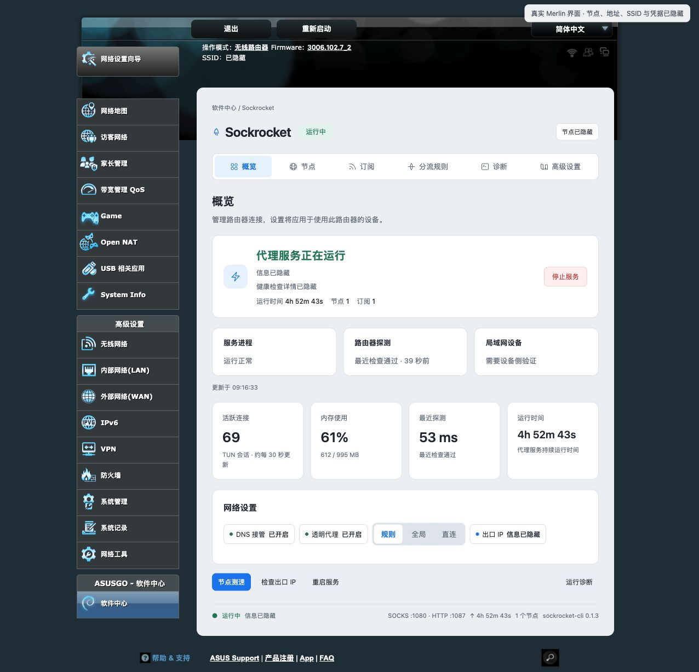
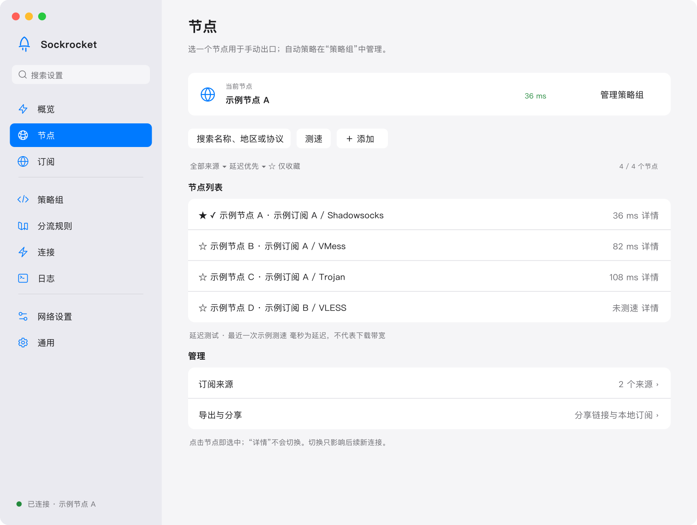
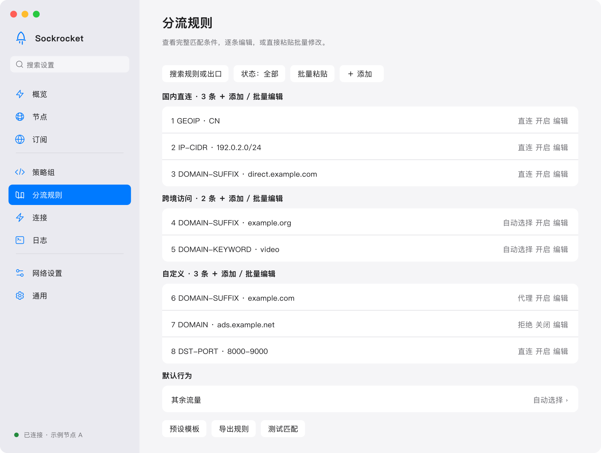
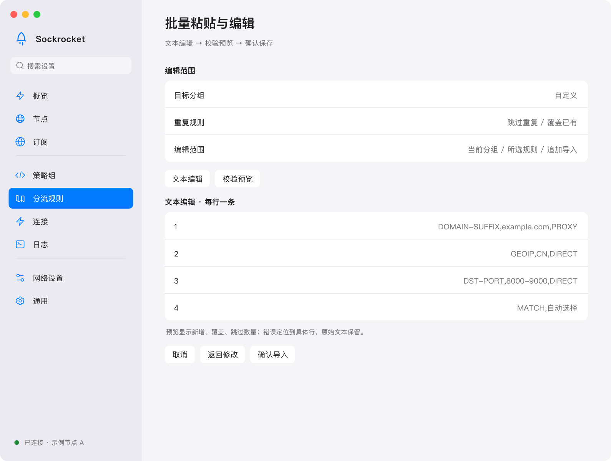

# Sockrocket 梅林路由器插件

<p align="center">
  
</p>

## 开源 Rust · 小安装包 · 低内存占用

离线安装包实测约 6.4 MiB。RT-AX86U Pro 在 153–172 个活跃会话下，代理进程常驻内存实测为 29–37 MiB。装在路由器上，全家设备共用节点、规则和 DNS。

<p align="center">
   <a href="README.vi.md">Tiếng Việt</a> · <strong>中文</strong>
</p>
<p align="center">
  <a href="https://sockrockets.github.io/sockrocket/">网站</a> · <a href="https://t.me/sockrocket">Telegram · @sockrocket</a> ·
  <a href="https://github.com/sockrockets/sockrocket/releases/latest">下载最新版</a> ·
  <a href="docs/getting-started.md">使用指南</a> ·
  <a href="docs/routing.md">分流</a> ·
  <a href="docs/merlin.md">Merlin 路由器</a> ·
  <a href="https://github.com/sockrockets/sockrocket/issues">反馈问题</a>
</p>

## 从安装到设备分流

1. 按完整型号及硬件修订选择下方安装包，在梅林软件中心离线安装。
2. 打开 Sockrocket，导入节点或订阅，选择可用出口并启动服务。
3. 在「分流规则」创建规则组，或从常用预设添加 AI、视频、游戏等规则。预设初始停用，检查内容后启用。
4. 选择「全部设备」或某台设备，绑定一个或多个规则组，分别指定优先级和出口。
5. 在流程图选择设备，输入目标网站并检查分流，核对命中的规则和出口。

规则组保存一份内容，多台设备可以复用。设备自己的关联先匹配，再检查「全部设备」关联。关联优先级越高越先匹配，同级按组内规则优先级与配置顺序匹配。设备名称可以自定义，建议在固件中保留 DHCP 地址。

「删除设备配置」清理该来源的组绑定、专属规则、默认出口和自定义名称。仍在线的设备会继续由 DHCP 或邻居表发现，之后可以重新配置；更大网段的策略仍可覆盖该设备。

## 内置预设与链接导入

| 场景 | 可选预设 |
| --- | --- |
| AI | AI 服务（ChatGPT、Claude、Gemini）、AI 扩展（Perplexity、Poe、Grok、Mistral、Hugging Face、创作工具） |
| 视频 | YouTube / Netflix、Disney+、Prime Video、Twitch / TikTok / Hulu / Max / Crunchyroll / Vimeo |
| 音乐 | Spotify、Tidal、SoundCloud、Deezer |
| 游戏 | Steam、Epic / Fortnite、PlayStation / Xbox / Nintendo、EA / Ubisoft / Battle.net / Riot / Rockstar |
| 社区 | Telegram、Discord / TeamSpeak / Reddit |
| 其他 | 开发工具、Apple、Microsoft、国内常用网站、Emby 日本 / 美国 / 直连域名 |

预设适合按场景选择出口。服务会调整域名和 CDN，游戏对战还可能直接访问动态 IP，并使用 UDP；这些域名规则不能保证所有游戏连接或地区解锁。可用连接列表和分流检查补充个别规则。

选择具名规则组后，使用「从链接添加」读取 HTTP(S) 原始规则列表，预览并确认追加。支持的目的规则包含完整域名、域名后缀、关键词、IP 网段、GeoIP 和端口。链接导入是手动操作，保存后按组绑定生效。同组重复条目会跳过。

## 自定义 Hosts

在「网络与 DNS」的「自定义 Hosts」中，每行填写一个 IP 地址和一个完整域名，例如 `192.168.1.10 nas.home.arpa`。保存并应用后，使用 Sockrocket DNS 的设备查询该域名时会得到指定地址。支持 IPv4 和 IPv6，同一域名的多个地址分行填写。删除对应行并保存即可恢复常规解析。通过页面保存时无需手动重启路由器或代理；局域网本地记录变化时，插件会自动重启固件 DNS 转发服务。

## 日常维护

- 更新前查看插件状态与磁盘空间，使用软件中心离线包或插件更新入口。升级失败时查看诊断与更新状态。
- 修改规则后以「检查分流」核对新连接判定。已有连接可能仍使用建立时的出口。
- 网络异常时先检查节点可用性、DNS 和设备来源 IP，再核对组是否启用、是否绑定、绑定优先级以及默认出口。
- 提交问题时附固件版本、路由器完整型号、插件版本和脱敏诊断。订阅 URL、访问令牌、节点密码及设备标识应先移除。

详细安装与架构说明见 [梅林安装指南](merlin/README.md)，规则工作方式见 [分流说明](docs/routing.md)。下面的功能描述对应当前源码，已发布安装包以发布说明为准。

## 按路由器型号下载安装包

在表中查找机身完整型号和硬件修订版，下载对应文件，再进入软件中心离线安装。表中列出打包目标，固件用户空间决定架构。

| 路由器型号 | 固件架构 | 离线安装包 |
| --- | --- | --- |
| RT-AC68U、RT-AC68U V4、RT-AC66U B1、RT-AC1900、RT-AC1900P、RT-AC87U、Netgear R6300 V2、RT-AC88U、RT-AC3100、RT-AC3200、RT-AC5300 | ARMv7 软浮点 | [sockrocket-merlin-arm.tar.gz](https://github.com/sockrockets/sockrocket/releases/latest/download/sockrocket-merlin-arm.tar.gz) |
| RT-BE92U、RT-BE82U、RT-BE58 Go、GS7 Pro、GS7 Pro Max、TUF-BE3600、TUF-BE3600 V2、TUF-AX5400 V2、ZenWiFi ET8、ZenWiFi XD6、ZenWiFi XT9、TUF-AX3000、TUF-AX3000 V2、TUF-AX5400、RT-AX58U、RT-AX58U V2、RAX70、RT-AX1800、RAX50、RT-AX82U、RT-AX82U V2、ZenWiFi XT8、ZenWiFi XT8 V2、ZenWiFi XD4、ZenWiFi XD4 Plus、RT-AX56U、RT-AX56U V2、RT-AX57、RT-AX55 | ARMv7 硬浮点 | [sockrocket-merlin-hnd.tar.gz](https://github.com/sockrockets/sockrocket/releases/latest/download/sockrocket-merlin-hnd.tar.gz) |
| RT-AC86U、GT-AC2900、GT-AC5300、RT-AX88U、RT-AX88U PRO、RAX80、GT-AX11000、GT-AX11000 PRO、RT-AX92U、RT-AX68U、RT-AX86U、RT-AX86U PRO、RT-AX86S、GT-AXE11000、GT-AXE16000、GT-AX6000、ZenWiFi Pro XT12、RT-BE88U、RT-BE7200、RT-BE86U、RT-BE96U、GT-BE96、GT-BE98、GT-BE98 Pro、GT-BE19000AI | AArch64 | [sockrocket-merlin-hnd_v8.tar.gz](https://github.com/sockrockets/sockrocket/releases/latest/download/sockrocket-merlin-hnd_v8.tar.gz) |
| RT-AX89X | ARMv7 硬浮点 | [sockrocket-merlin-qca.tar.gz](https://github.com/sockrockets/sockrocket/releases/latest/download/sockrocket-merlin-qca.tar.gz) |
| GS7、GS7 Air、GS-BE7200X、TX-AX6000、ZenWiFi BT8P、RT-AX57 Go、TUF-AX4200Q、TUF-AX4200、TUF-AX6000、RT-AX59U | AArch64 | [sockrocket-merlin-mtk.tar.gz](https://github.com/sockrockets/sockrocket/releases/latest/download/sockrocket-merlin-mtk.tar.gz) |
| ZenWiFi BD4 | ARMv7 硬浮点 | [sockrocket-merlin-ipq32.tar.gz](https://github.com/sockrockets/sockrocket/releases/latest/download/sockrocket-merlin-ipq32.tar.gz) |
| TUF-BE6500 | AArch64 | [sockrocket-merlin-ipq64.tar.gz](https://github.com/sockrockets/sockrocket/releases/latest/download/sockrocket-merlin-ipq64.tar.gz) |



## 主要能力

| 能力 | 用途 |
| --- | --- |
| 原生协议 | Shadowsocks、VMess、VLESS、Trojan、TUIC、Hysteria2、AnyTLS、WireGuard |
| 节点与订阅 | 导入节点链接或 Clash / V2Ray / sing-box 订阅，更新、搜索、去重与延迟测试 |
| 分流 | 规则、全局、直连。出口是全局节点、单个节点，或节点分组。见[分流](docs/routing.md) |
| 流量接管 | 系统代理适合常用应用；TUN 用于需要接管更多流量的场景 |
| 连接与用量 | 概览统计本次进程启动以来的流量。订阅页按节点和订阅显示最近三个自然月 |
| 多端复用 | 桌面 GUI、CLI 与 Merlin WebUI，共用 Rust 内核 |
| 多语言 | 中文、English、Tiếng Việt |

协议与传输组合存在能力边界：ShadowTLS 不提供 UDP，VMess 原生 UDP 和 WireGuard UDP 有单包大小限制；VLESS Vision 支持 TLS 1.3/REALITY TCP 与 XUDP，标准 flow 拒绝 UDP/443；gRPC/XHTTP 尚未实现，相关配置会明确拒绝。详见[协议说明](docs/protocols.md)。软件不提供代理节点或订阅服务。

## 新增协议：AnyTLS 与 WireGuard

> **版本范围**：以下描述当前源码能力。GitHub Releases 中的安装包以对应版本发布说明为准。

| 协议 | 使用能力 | 当前边界 |
| --- | --- | --- |
| AnyTLS v2 | 原生 TLS、会话复用、TCP 与 UDP-over-TCP v2；支持分享链接、Clash / sing-box 导入 | 默认验证证书；UDP 通过 TCP 承载 |
| WireGuard | 原生用户态 TCP / UDP、预共享密钥、隧道内 DNS；支持单 Peer 配置文件和 Clash / sing-box 导入 | 每节点一个 Peer；UDP 需符合 MTU；不支持 IP 分片或配置脚本 |

桌面端、CLI 和 Merlin 复用同一实现，节点与订阅沿用本机配置持久化。WireGuard 协议本身不创建额外系统网卡，也不修改系统路由或 DNS；应用的 TUN 接管由独立设置控制。两种协议均已通过独立服务端互通测试。

详细格式、限制及尚未实现的 gRPC/XHTTP 见[协议说明](docs/protocols.md)。

## 界面预览：了解日常操作

### 节点与订阅，分开管理

订阅管理来源，节点决定当前出口。延迟测试通过代理执行；毫秒数表示测试时的响应延迟，不代表下载带宽。



### 规则可以查看，也可以逐条修改

按匹配条件、出口与启用状态检查规则。规则顺序和优先级会影响最终路由。规则分组是规则的文件夹；节点分组是出口。只有规则模式会看它们。



### 多条规则，用文本批量处理

批量粘贴与分组编辑适合迁移已有规则。先检查解析结果、目标出口与冲突处理方式，再保存。示例域名使用保留的 `example.com`，不指向个人服务。



## 一条规则走哪里

全局模式走页面顶部当前选中的节点。直连不走代理。只有规则模式会看规则。

| 出口 | 跟着谁走 |
| --- | --- |
| 全局节点 | 顶部当前节点，包括健康检查自动切换 |
| 单个节点 | 只走这一个。换顶部节点时它不动 |
| 节点分组 | 这个分组的成员和策略。分组里换成员，不改变全局节点 |

手动分组只用一个节点。备用按列表顺序尝试，五分钟内从上次连上的成员开始，UDP 固定走第一个。测速把更快的握手保留五分钟，列表顺序不决定用哪一个。分组要生效，规则的出口必须选成它。步骤见[分流](docs/routing.md)。

## Merlin 页面上

桌面端共用这一套内核。下面这些操作在路由器 WebUI 里。

| 页面 | 能做什么 |
| --- | --- |
| 概览 | 启动会同时打开 DNS 接管和透明代理。运行中可以分别关掉。这里的用量是本次进程启动以来的 |
| 节点 | 使用一个节点，或建节点分组。钉住的节点不存在时直接失败，不会改走全局节点。健康检查自动切换只移动全局节点 |
| 订阅 | 更新订阅。近三个月包含手动节点和直连。订阅合计是当前属于它的节点之和。不显示订阅地址 |
| 分流规则 | 给一组规则选出口，从链接预览并追加规则，检查某个网站会命中哪里（不发起连接），或添加预设。预设添加后是停用的：AI、海外视频、Telegram 网页、开发工具、Apple、Microsoft、国内站点。名单是常见域名，不是全部地址 |
| 设备兜底 | 给一台设备或一个网段单独的最终出口。其余设备仍走共用规则。请用固定 DHCP 地址。继承全局会删掉这个来源的最终规则，目的例外还在 |
| 网络与 DNS | 默认 IPv4 兼容，不要求运营商开通 IPv6。双栈只在固件已经有 IPv6 地址和 LAN 前缀时再开。保存会就地重做防火墙，不重启正在运行的代理 |

## 下载与第一次连接

下面每个文件名都是[最新发行版](https://github.com/sockrockets/sockrocket/releases/latest)里的那个文件。[网站下载表](https://sockrockets.github.io/sockrocket/#download)用同样的文件名，打开页面时会落到当前版本。路由器安装包按固件平台列在那里。

| 系统 | 桌面安装包 |
| --- | --- |
| macOS · Apple Silicon | [sockrocket-macos-aarch64.dmg](https://github.com/sockrockets/sockrocket/releases/latest/download/sockrocket-macos-aarch64.dmg) |
| macOS · Intel | [sockrocket-macos-x86_64.dmg](https://github.com/sockrockets/sockrocket/releases/latest/download/sockrocket-macos-x86_64.dmg) |
| Windows · x86_64 | [sockrocket-windows-x86_64.zip](https://github.com/sockrockets/sockrocket/releases/latest/download/sockrocket-windows-x86_64.zip) |
| Linux · x86_64 | [sockrocket-linux-x86_64.tar.gz](https://github.com/sockrockets/sockrocket/releases/latest/download/sockrocket-linux-x86_64.tar.gz) |
| Linux · ARM64 | [sockrocket-linux-aarch64.tar.gz](https://github.com/sockrockets/sockrocket/releases/latest/download/sockrocket-linux-aarch64.tar.gz) |

1. 安装并打开客户端。macOS 将应用拖入「应用程序」后运行；Windows 解压后运行；Linux 解压后按包内说明安装或启动。
2. 在「订阅」中添加你自己的订阅，或在「节点」中导入节点链接。
3. 更新订阅，选择节点；可先执行延迟测试。
4. 在「概览」点击连接，等待连通性验证结果，再确认系统代理状态。
5. 确有全流量接管需求时再开启 TUN，并完成系统要求的管理员授权。

升级时先退出旧版本及其管理员后台实例。两个版本同时运行会争用监听端口，也可能重复接管 TUN 路由。

## AsusWRT-Merlin

**梅林插件：小安装包，低内存占用**

v0.0.19 本地打包对照中，移除重复程序后，ARMv7 离线包为 6.36 MiB，ARM64 为 6.43 MiB，下载体积约减半。另一次 RT-AX86U Pro 实测中，153–172 个活跃会话下，代理进程的常驻内存（RSS）为 29–37 MiB。发行包大小随构建而异，内存占用随负载变化。 [内存实测记录](docs/architecture/tls-failure-investigation-2026-11-06.md)

路由器插件提供 WebUI、透明代理、DNS 接管和运行状态检查，让局域网设备共用代理内核。


1. 菜单里还没有软件中心时，先到 [fw.koolcenter.com](https://fw.koolcenter.com/) 按机型下载梅林改版或官改固件并刷入。原版 Merlin 没有软件中心。
2. 在[型号与安装包对照表](docs/merlin-models.md)按完整型号和固件架构查找文件名。打包产物附带同一份 `merlin-models.md`。
3. 按[Merlin 安装指南](docs/merlin.md)配置 JFFS 与自定义脚本，并安装对应软件包。
4. 在路由器本机页面配置订阅，先验证节点可用，再开启所需的 DNS / 透明代理功能。要让节点分组接管一部分流量，保持规则模式，并把对应规则的出口选成这个分组。
5. 更新前备份配置；确认手动停止与网络恢复正常后再投入使用。

```sh
/jffs/addons/sockrocket/scripts/sockrocket.sh status
/jffs/addons/sockrocket/scripts/sockrocket.sh stop
/jffs/addons/sockrocket/scripts/sockrocket.sh start
```

平台差异、服务控制与故障恢复见 [Merlin 指南](docs/merlin.md)和[技术参考](docs/merlin-reference.md)。

## 系统代理与 TUN 怎么选

| 方式 | 适用场景 | 注意事项 |
| --- | --- | --- |
| 系统代理 | 浏览器及遵循系统代理设置的应用 | 不保证所有应用都使用它 |
| TUN | 需要接管更多应用流量 | 需要管理员权限和可用的 TUN 环境；先关闭其他 TUN / VPN |
| CLI 本地监听 | 终端或手动配置代理的应用 | 默认仅监听本机；按需要配置调用方 |

默认本地端口：SOCKS5 `127.0.0.1:1080`，HTTP `127.0.0.1:1087`。这些是本机监听地址，不是远端节点。

## 命令行

CLI 文件与桌面安装包在同一发布页，名称以 `sockrocket-cli-` 开头。

```sh
sockrocket-cli --init config.yaml
# 在本机编辑配置，填入你自己的订阅或节点
sockrocket-cli config.yaml
```

用 `Ctrl+C` 停止。完整字段与安全示例见[配置参考](docs/configuration.md)。不要把填入真实凭据后的配置提交到仓库。

## 常见问题

| 现象 | 先检查 |
| --- | --- |
| 点击连接后启动失败 | 是否有旧版后台进程；本地端口是否被占用；查看日志中的错误 |
| TUN 无法开启 | 管理员授权、驱动环境，以及是否已有其他 TUN 占用默认路由 |
| 显示已连接但网页打不开 | 分别检查节点连通性、系统代理 / TUN、DNS 与路由规则 |
| 订阅失败或没有节点 | 在本机核对地址、格式、服务器响应与解析结果 |
| 只有部分网站不可达 | 检查命中的规则、直连出口及 DNS，避免多个客户端同时接管 |
| 分组建了但流量没走它 | 概览要停在规则模式，并且某条规则的出口是「分组 · 名字」。全局和直连不看分组 |
| 重启后用量像是清空了 | 概览从这次进程启动重新累计。近三个月在订阅页 |

## 社区与联系方式

| | |
| --- | --- |
| [Telegram · @sockrocket](https://t.me/sockrocket) | 发布公告与项目动态 |
| [GitHub Discussions](https://github.com/sockrockets/sockrocket/discussions) | 使用问答、功能建议与交流 |
| [GitHub Issues](https://github.com/sockrockets/sockrocket/issues) | 可复现的缺陷反馈 |
| [网站](https://sockrockets.github.io/sockrocket/) | 产品介绍、下载与文档 |

## 隐私与反馈

配置、备份和运行日志默认只保存在本机，并使用私有文件权限。管理接口只监听本机。默认日志是 info，只有设置了诊断日志文件时才升到 debug。完整说明见 [隐私保护](docs/privacy-protection.md)。

桌面设计配图使用虚构数据；Merlin 实际界面截图在导出前脱敏。提交 Issue、日志或截图前，请移除订阅完整 URL、查询参数、节点地址、密码、UUID、令牌、二维码、个人路径和账户信息。二维码与分享链接也可能包含完整凭据。提交和标签使用项目身份；`noreply` 地址不是个人信息。

- [Issues](https://github.com/sockrockets/sockrocket/issues)：报告缺陷。
- [Discussions](https://github.com/sockrockets/sockrocket/discussions)：使用讨论。
- [文档目录](docs/README.md)：分流、配置、协议、架构和开发说明。

## 许可

[Apache License 2.0](LICENSE)。本项目关于 AI / ML 训练使用的声明见 [ai.txt](ai.txt)、[robots.txt](robots.txt)和 [TDM 声明](.well-known/tdmrep.json)。
