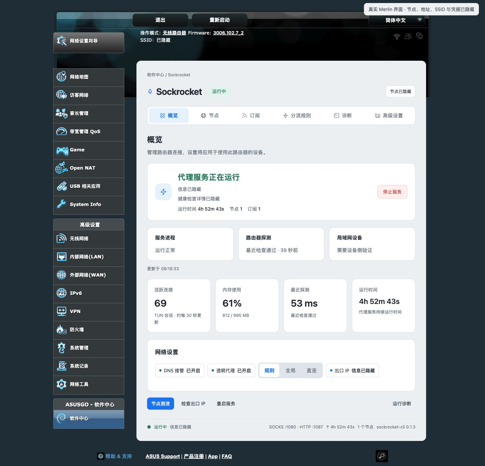
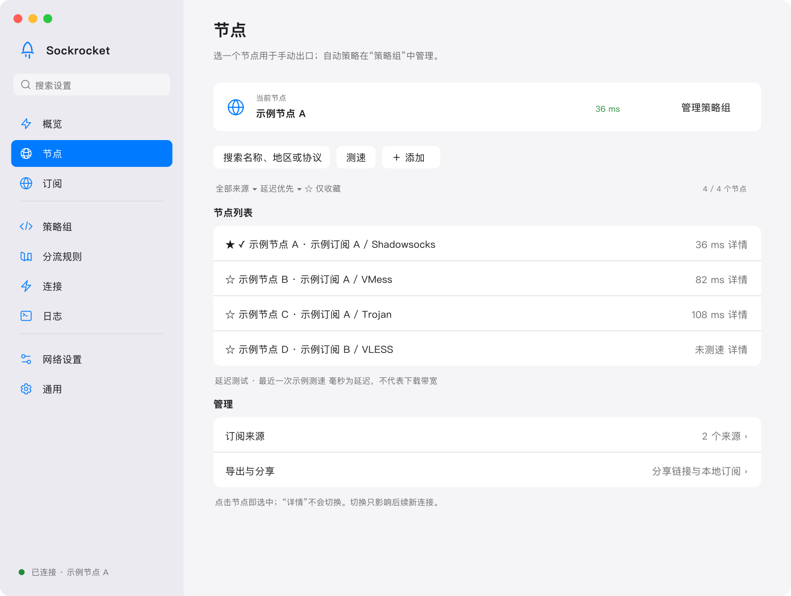
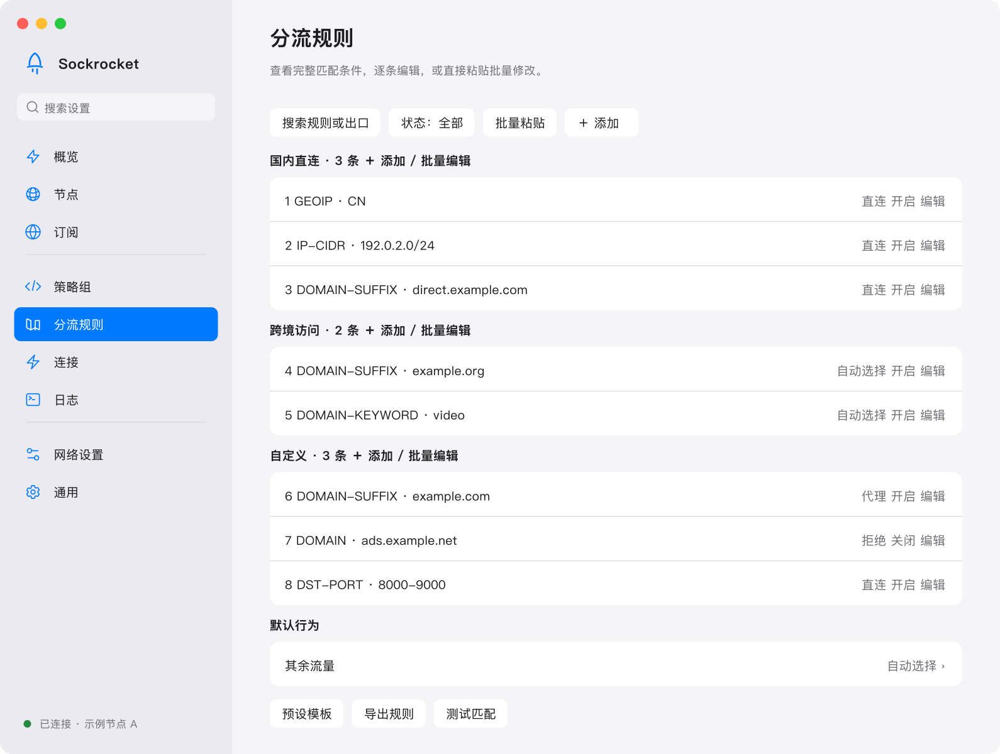
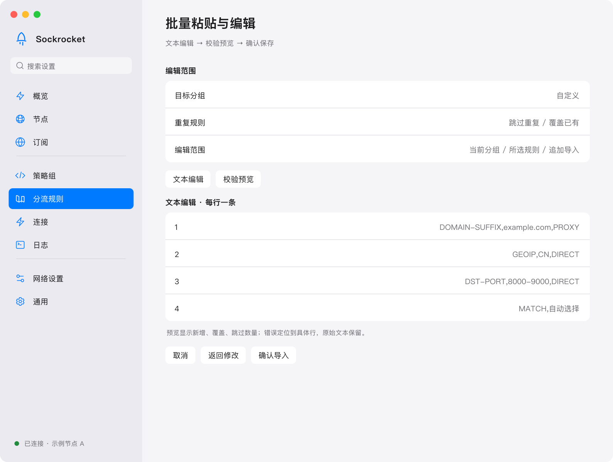

# Sockrocket cho router AsusWRT-Merlin

<p align="center">
  
</p>
## Rust mã nguồn mở · Gói cài nhỏ · Dùng ít RAM

Gói cài đặt ngoại tuyến trong thử nghiệm có dung lượng khoảng 6.4 MiB. Trên RT-AX86U Pro với 153–172 phiên hoạt động, tiến trình proxy dùng 29–37 MiB bộ nhớ thường trú. Cài trên router để cả nhà dùng chung node, quy tắc và DNS.

<p align="center"><a href="README.md">English</a> · <strong>Tiếng Việt</strong> · <a href="README.zh.md">中文</a></p>
<p align="center">
  <a href="https://sockrockets.github.io/sockrocket/">Website</a> · <a href="https://t.me/sockrocket">Telegram · @sockrocket</a> ·
  <a href="https://github.com/sockrockets/sockrocket/releases/latest">Tải xuống</a> ·
  <a href="docs/getting-started.md">Bắt đầu</a> ·
  <a href="docs/routing.md">Định tuyến</a> ·
  <a href="docs/merlin.md">Hướng dẫn Merlin</a> ·
  <a href="https://github.com/sockrockets/sockrocket/issues">Báo lỗi</a>
</p>

## Tải gói theo model router

Tra đúng tên model và phiên bản phần cứng, tải gói tương ứng rồi cài trong Software Center. Bảng liệt kê các mục tiêu đóng gói theo kiến trúc không gian người dùng của firmware.

| Model router | Kiến trúc firmware | Gói cài ngoại tuyến |
| --- | --- | --- |
| RT-AC68U, RT-AC68U V4, RT-AC66U B1, RT-AC1900, RT-AC1900P, RT-AC87U, Netgear R6300 V2, RT-AC88U, RT-AC3100, RT-AC3200, RT-AC5300 | ARMv7 soft-float | [sockrocket-merlin-arm.tar.gz](https://github.com/sockrockets/sockrocket/releases/latest/download/sockrocket-merlin-arm.tar.gz) |
| RT-BE92U, RT-BE82U, RT-BE58 Go, GS7 Pro, GS7 Pro Max, TUF-BE3600, TUF-BE3600 V2, TUF-AX5400 V2, ZenWiFi ET8, ZenWiFi XD6, ZenWiFi XT9, TUF-AX3000, TUF-AX3000 V2, TUF-AX5400, RT-AX58U, RT-AX58U V2, RAX70, RT-AX1800, RAX50, RT-AX82U, RT-AX82U V2, ZenWiFi XT8, ZenWiFi XT8 V2, ZenWiFi XD4, ZenWiFi XD4 Plus, RT-AX56U, RT-AX56U V2, RT-AX57, RT-AX55 | ARMv7 hard-float | [sockrocket-merlin-hnd.tar.gz](https://github.com/sockrockets/sockrocket/releases/latest/download/sockrocket-merlin-hnd.tar.gz) |
| RT-AC86U, GT-AC2900, GT-AC5300, RT-AX88U, RT-AX88U PRO, RAX80, GT-AX11000, GT-AX11000 PRO, RT-AX92U, RT-AX68U, RT-AX86U, RT-AX86U PRO, RT-AX86S, GT-AXE11000, GT-AXE16000, GT-AX6000, ZenWiFi Pro XT12, RT-BE88U, RT-BE7200, RT-BE86U, RT-BE96U, GT-BE96, GT-BE98, GT-BE98 Pro, GT-BE19000AI | AArch64 | [sockrocket-merlin-hnd_v8.tar.gz](https://github.com/sockrockets/sockrocket/releases/latest/download/sockrocket-merlin-hnd_v8.tar.gz) |
| RT-AX89X | ARMv7 hard-float | [sockrocket-merlin-qca.tar.gz](https://github.com/sockrockets/sockrocket/releases/latest/download/sockrocket-merlin-qca.tar.gz) |
| GS7, GS7 Air, GS-BE7200X, TX-AX6000, ZenWiFi BT8P, RT-AX57 Go, TUF-AX4200Q, TUF-AX4200, TUF-AX6000, RT-AX59U | AArch64 | [sockrocket-merlin-mtk.tar.gz](https://github.com/sockrockets/sockrocket/releases/latest/download/sockrocket-merlin-mtk.tar.gz) |
| ZenWiFi BD4 | ARMv7 hard-float | [sockrocket-merlin-ipq32.tar.gz](https://github.com/sockrockets/sockrocket/releases/latest/download/sockrocket-merlin-ipq32.tar.gz) |
| TUF-BE6500 | AArch64 | [sockrocket-merlin-ipq64.tar.gz](https://github.com/sockrockets/sockrocket/releases/latest/download/sockrocket-merlin-ipq64.tar.gz) |



## Tính năng

| Khả năng | Mục đích |
| --- | --- |
| Giao thức native | Shadowsocks, VMess, VLESS, Trojan, TUIC, Hysteria2, AnyTLS và WireGuard |
| Node và subscription | Nhập liên kết node hoặc subscription Clash / V2Ray / sing-box; cập nhật, tìm kiếm, lọc trùng và đo độ trễ |
| Định tuyến | Rule, Global và Direct. Lối ra là node toàn cục, một node, hoặc một nhóm node. Xem [Định tuyến](docs/routing.md) |
| Chuyển lưu lượng | Proxy hệ thống cho ứng dụng tương thích; TUN để xử lý nhiều ứng dụng hơn |
| Kết nối và lưu lượng | Tổng quan tính byte từ khi tiến trình này khởi động. Trang subscription hiện ba tháng dương lịch gần nhất theo node và theo subscription |
| Dùng chung lõi | GUI desktop, CLI và Merlin WebUI |
| Ngôn ngữ | English, Tiếng Việt và 中文 |

Các tổ hợp giao thức có giới hạn: ShadowTLS không cung cấp UDP; UDP native của VMess và WireGuard có giới hạn kích thước mỗi gói. VLESS Vision hỗ trợ TLS 1.3/REALITY qua TCP và XUDP; flow tiêu chuẩn từ chối UDP/443. gRPC/XHTTP chưa được triển khai và sẽ bị từ chối rõ ràng. Xem [hướng dẫn giao thức](docs/protocols.md). Sockrocket không cung cấp node hoặc dịch vụ subscription.

## Giao thức mới: AnyTLS và WireGuard

> **Phạm vi phiên bản:** các tính năng này mô tả mã nguồn hiện tại. Gói trên GitHub Releases tuân theo ghi chú của từng phiên bản.

| Giao thức | Khả năng | Giới hạn hiện tại |
| --- | --- | --- |
| AnyTLS v2 | TLS native, tái sử dụng phiên, TCP và UDP-over-TCP v2; nhập liên kết, Clash và sing-box | Mặc định xác minh chứng chỉ; UDP được truyền qua TCP |
| WireGuard | TCP / UDP trong tiến trình, khóa chia sẻ trước và DNS trong đường hầm; nhập cấu hình một peer, Clash và sing-box | Một peer mỗi node; UDP phải nằm trong MTU; chưa hỗ trợ phân mảnh IP hoặc script cấu hình |

Desktop, CLI và Merlin dùng chung cách triển khai và cơ chế lưu cấu hình trên thiết bị. Đường truyền WireGuard không tạo thêm giao diện mạng hay thay đổi tuyến mạng và DNS của hệ thống; chế độ TUN của ứng dụng được điều khiển riêng. Cả hai giao thức đã vượt qua kiểm tra tương thích với máy chủ độc lập.

Xem [hướng dẫn giao thức](docs/protocols.md) để biết định dạng, giới hạn và phần Vision, gRPC/XHTTP chưa triển khai.

## Giao diện và thao tác

### Quản lý nguồn và chọn node riêng biệt

Subscription quản lý nguồn node; lựa chọn node xác định đường ra hiện tại. Phép đo độ trễ đi qua proxy. Đơn vị mili giây thể hiện độ trễ phản hồi lúc đo, không phải băng thông tải xuống.



### Xem và chỉnh sửa quy tắc

Kiểm tra điều kiện khớp, đích và trạng thái bật. Thứ tự và độ ưu tiên ảnh hưởng kết quả. Nhóm quy tắc là thư mục quy tắc. Nhóm node là lối ra. Chỉ chế độ Rule đọc chúng.



### Chỉnh sửa nhiều quy tắc bằng văn bản

Dán hàng loạt và sửa theo nhóm giúp chuyển quy tắc có sẵn. Kiểm tra kết quả phân tích, đích và cách xử lý xung đột trước khi lưu. Domain `example.com` được dành cho tài liệu.



## Lưu lượng của một quy tắc đi đâu

Chế độ Global dùng node đang chọn ở đầu trang. Direct không dùng proxy. Chỉ chế độ Rule đọc quy tắc.

| Lối ra | Đi theo |
| --- | --- |
| Node toàn cục | Node đang chọn ở đầu trang, kể cả khi kiểm tra sức khỏe tự đổi |
| Một node | Chỉ node đó. Đổi lựa chọn ở đầu trang không làm quy tắc này đổi theo |
| Nhóm node | Thành viên và chiến lược của nhóm. Đổi thành viên không đổi node toàn cục |

Nhóm thủ công dùng một node. Dự phòng thử theo thứ tự và, trong năm phút, bắt đầu lại từ lần kết nối thành công gần nhất; UDP luôn đi qua thành viên đầu tiên. URL test giữ bắt tay nhanh nhất trong năm phút, thứ tự danh sách không chọn người thắng. Nhóm chưa có tác dụng cho đến khi lối ra của một quy tắc là nhóm đó. Các bước: [Định tuyến](docs/routing.md).

## Trên trang Merlin

Ứng dụng desktop dùng cùng lõi này. Các thao tác dưới đây nằm trong WebUI của router.

| Trang | Việc có thể làm |
| --- | --- |
| Tổng quan | Khởi động bật cùng lúc chặn DNS và proxy trong suốt. Khi đang chạy có thể tắt riêng từng cái. Lưu lượng ở đây tính từ khi tiến trình này khởi động |
| Node | Dùng một node hoặc tạo nhóm node. Node được ghim mà không còn thì thất bại, không chuyển sang node toàn cục. Tự đổi khi kiểm tra sức khỏe chỉ di chuyển node toàn cục |
| Subscription | Cập nhật subscription. Ba tháng gần nhất gồm node thủ công và Direct. Tổng của subscription là tổng các node hiện thuộc nó. Không hiện địa chỉ |
| Quy tắc định tuyến | Chọn lối ra cho một thư mục quy tắc, kiểm tra một trang sẽ khớp đâu mà không mở kết nối, hoặc thêm mẫu. Mẫu được thêm ở trạng thái tắt: AI, video nước ngoài, web Telegram, công cụ lập trình, Apple, Microsoft và trang trong nước. Đó là tên miền phổ biến, không phải mọi địa chỉ |
| Mặc định theo thiết bị | Lối ra cuối cho một thiết bị hoặc một dải. Thiết bị khác vẫn dùng quy tắc chung. Hãy dùng địa chỉ DHCP cố định. Kế thừa toàn cục xóa quy tắc cuối của nguồn đó và giữ ngoại lệ theo đích |
| Mạng và DNS | Mặc định tương thích IPv4, không yêu cầu nhà mạng bật IPv6. Dual-stack chỉ khi firmware đã có địa chỉ IPv6 và tiền tố LAN. Lưu áp lại tường lửa tại chỗ, không khởi động lại proxy đang chạy |

## Tải xuống và kết nối

Mỗi tên tệp dưới đây là đúng tệp đó trong [bản phát hành mới nhất](https://github.com/sockrockets/sockrocket/releases/latest). [Bảng tải trên website](https://sockrockets.github.io/sockrocket/#download) dùng cùng tên và trỏ tới bản hiện tại khi mở trang. Gói router được liệt kê ở đó theo nền tảng firmware.

| Hệ thống | Gói desktop |
| --- | --- |
| macOS · Apple Silicon | [sockrocket-macos-aarch64.dmg](https://github.com/sockrockets/sockrocket/releases/latest/download/sockrocket-macos-aarch64.dmg) |
| macOS · Intel | [sockrocket-macos-x86_64.dmg](https://github.com/sockrockets/sockrocket/releases/latest/download/sockrocket-macos-x86_64.dmg) |
| Windows · x86_64 | [sockrocket-windows-x86_64.zip](https://github.com/sockrockets/sockrocket/releases/latest/download/sockrocket-windows-x86_64.zip) |
| Linux · x86_64 | [sockrocket-linux-x86_64.tar.gz](https://github.com/sockrockets/sockrocket/releases/latest/download/sockrocket-linux-x86_64.tar.gz) |
| Linux · ARM64 | [sockrocket-linux-aarch64.tar.gz](https://github.com/sockrockets/sockrocket/releases/latest/download/sockrocket-linux-aarch64.tar.gz) |

1. Cài đặt và mở ứng dụng. Trên macOS, kéo ứng dụng vào Applications trước; trên Windows, giải nén ZIP; trên Linux, làm theo hướng dẫn trong gói.
2. Thêm subscription của bạn trong **Subscriptions**, hoặc nhập liên kết ở **Nodes**.
3. Cập nhật subscription và chọn node; đo độ trễ nếu cần.
4. Nhấn **Connect** ở **Overview**, chờ kiểm tra kết nối rồi kiểm tra proxy hệ thống.
5. Chỉ bật **TUN** khi cần và hoàn tất yêu cầu quyền quản trị của hệ điều hành.

Trước khi nâng cấp, thoát bản cũ và tiến trình nền chạy với quyền quản trị. Hai phiên bản chạy cùng lúc có thể tranh chấp cổng và tuyến TUN.

## AsusWRT-Merlin

**Plugin Merlin nhỏ gọn, dùng ít RAM**

Trong thử nghiệm đóng gói v0.0.19, gói cài đặt ngoại tuyến có dung lượng 6.36 MiB trên ARMv7 và 6.43 MiB trên ARM64, giảm khoảng 49% sau khi bỏ bản sao của tệp thực thi. Trong một thử nghiệm riêng trên RT-AX86U Pro với 153–172 phiên hoạt động, tiến trình proxy dùng 29–37 MiB bộ nhớ thường trú (RSS). Dung lượng gói tùy bản dựng và mức dùng RAM tùy tải. [Số liệu bộ nhớ trên router](docs/architecture/tls-failure-investigation-2026-11-06.md)

Plugin router cung cấp WebUI, proxy trong suốt, chuyển DNS và kiểm tra dịch vụ cho các thiết bị LAN.


1. Nếu menu chưa có Software Center, tải bản Merlin hoặc bản mod chính hãng đúng model từ [fw.koolcenter.com](https://fw.koolcenter.com/) rồi flash. Merlin gốc không có Software Center.
2. Tra tên model và kiến trúc firmware trong [bảng đối chiếu gói](docs/merlin.md#model--platform). Mỗi bộ gói có kèm tệp `merlin-models.md`.
3. Làm theo [hướng dẫn Merlin](docs/merlin.md) để cấu hình JFFS / custom scripts và cài gói.
4. Cấu hình subscription trên router; kiểm tra node trước khi bật chuyển DNS hoặc proxy trong suốt. Để một phần lưu lượng đi qua nhóm node, giữ chế độ Rule và đặt lối ra của quy tắc thành nhóm đó.
5. Sao lưu cấu hình trước khi cập nhật và kiểm tra thao tác dừng / khôi phục mạng trước khi sử dụng lâu dài.

```sh
/jffs/addons/sockrocket/scripts/sockrocket.sh status
/jffs/addons/sockrocket/scripts/sockrocket.sh stop
/jffs/addons/sockrocket/scripts/sockrocket.sh start
```

Chi tiết nền tảng, dịch vụ và khôi phục: [Merlin](docs/merlin.md) · [Tài liệu kỹ thuật](docs/merlin-reference.md).

## Proxy hệ thống hay TUN?

| Chế độ | Trường hợp sử dụng | Lưu ý |
| --- | --- | --- |
| Proxy hệ thống | Trình duyệt và ứng dụng tuân theo cài đặt proxy của OS | Một số ứng dụng bỏ qua cài đặt này |
| TUN | Chuyển lưu lượng của nhiều ứng dụng hơn | Cần quyền quản trị và hỗ trợ TUN; tắt TUN / VPN khác trước |
| CLI listener | Công cụ terminal hoặc ứng dụng cấu hình thủ công | Mặc định chỉ lắng nghe trên máy; cấu hình ứng dụng gọi proxy |

Cổng local mặc định: SOCKS5 `127.0.0.1:1080`, HTTP `127.0.0.1:1087`. Đây là listener loopback, không phải node từ xa.

## Dòng lệnh

CLI có trên cùng trang phát hành, tên file bắt đầu bằng `sockrocket-cli-`.

```sh
sockrocket-cli --init config.yaml
# Chỉnh cấu hình local với subscription hoặc node của bạn.
sockrocket-cli config.yaml
```

Dừng bằng `Ctrl+C`. Xem [tài liệu cấu hình](docs/configuration.md) để biết các trường và ví dụ an toàn. Không commit cấu hình có thông tin xác thực thật.

## Xử lý sự cố

| Hiện tượng | Kiểm tra đầu tiên |
| --- | --- |
| Connect không khởi động được | Tiến trình nền bản cũ, cổng bị chiếm và lỗi trong log |
| Không bật được TUN | Quyền quản trị, driver và TUN khác đang giữ tuyến mặc định |
| Đã kết nối nhưng không mở được web | Kiểm tra riêng node, proxy hệ thống / TUN, DNS và quy tắc |
| Subscription lỗi hoặc không có node | Kiểm tra URL, định dạng, phản hồi máy chủ và kết quả phân tích trên máy |
| Chỉ một số trang bị lỗi | Quy tắc khớp, đường ra Direct, DNS và nhiều client cùng chuyển lưu lượng |
| Đã tạo nhóm nhưng lưu lượng không đi qua | Tổng quan phải ở chế độ Rule, và lối ra của một quy tắc phải là Nhóm · tên. Global và Direct bỏ qua nhóm |
| Khởi động lại thì lưu lượng như bị xóa | Bộ đếm trên Tổng quan bắt đầu lại cùng tiến trình. Ba tháng nằm ở trang Subscription |

## Cộng đồng & liên hệ

| | |
| --- | --- |
| [Telegram · @sockrocket](https://t.me/sockrocket) | Thông báo phát hành và cập nhật |
| [GitHub Discussions](https://github.com/sockrockets/sockrocket/discussions) | Hỏi đáp và ý tưởng |
| [GitHub Issues](https://github.com/sockrockets/sockrocket/issues) | Báo lỗi kèm bước tái hiện |
| [Website](https://sockrockets.github.io/sockrocket/) | Giới thiệu, tải xuống và tài liệu |

## Quyền riêng tư và phản hồi

Hình thiết kế desktop dùng dữ liệu giả; ảnh Merlin được ẩn thông tin trước khi xuất. Trước khi chia sẻ Issue, log hoặc ảnh, hãy xóa URL subscription đầy đủ và tham số truy vấn, địa chỉ máy chủ, mật khẩu, UUID, token, mã QR, đường dẫn cá nhân và thông tin tài khoản. Mã QR và liên kết chia sẻ có thể chứa toàn bộ thông tin xác thực.

- [Issues](https://github.com/sockrockets/sockrocket/issues): báo lỗi.
- [Discussions](https://github.com/sockrockets/sockrocket/discussions): hỏi đáp.
- [Mục lục tài liệu](docs/README.md): định tuyến, cấu hình, giao thức, kiến trúc và phát triển.

## Giấy phép

[Apache License 2.0](LICENSE). Xem [ai.txt](ai.txt), [robots.txt](robots.txt) và [tuyên bố TDM](.well-known/tdmrep.json) về việc sử dụng cho huấn luyện AI / ML.
