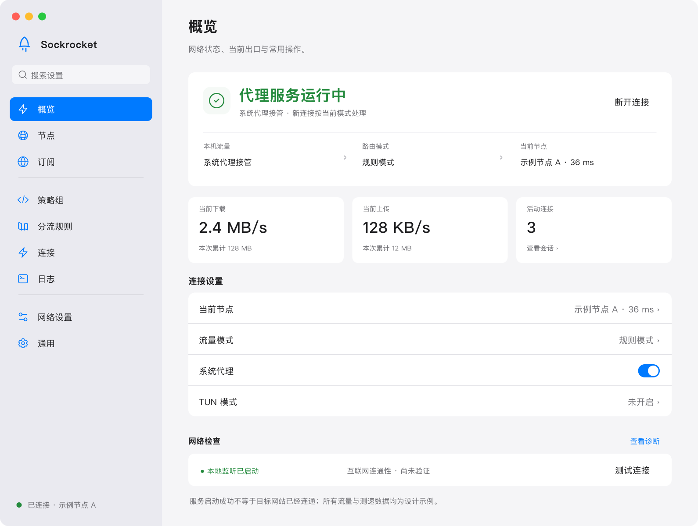
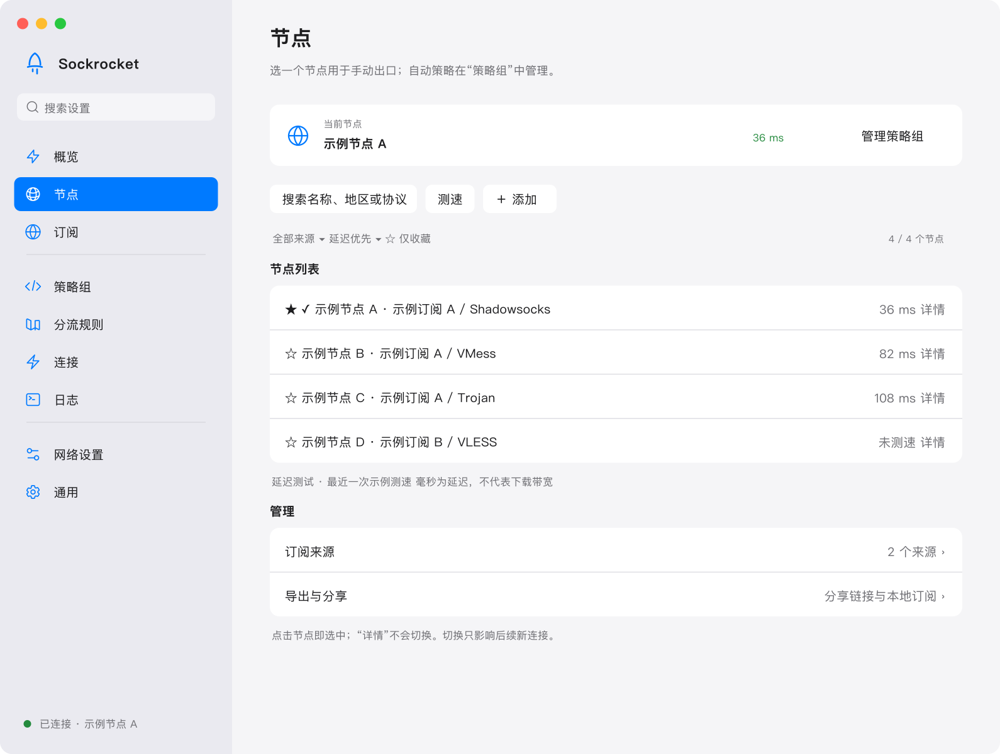
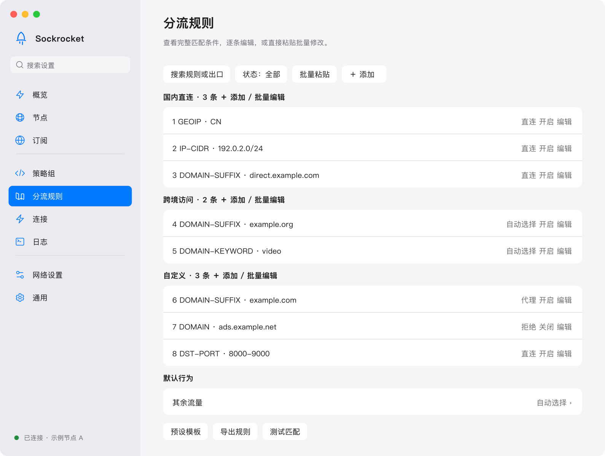
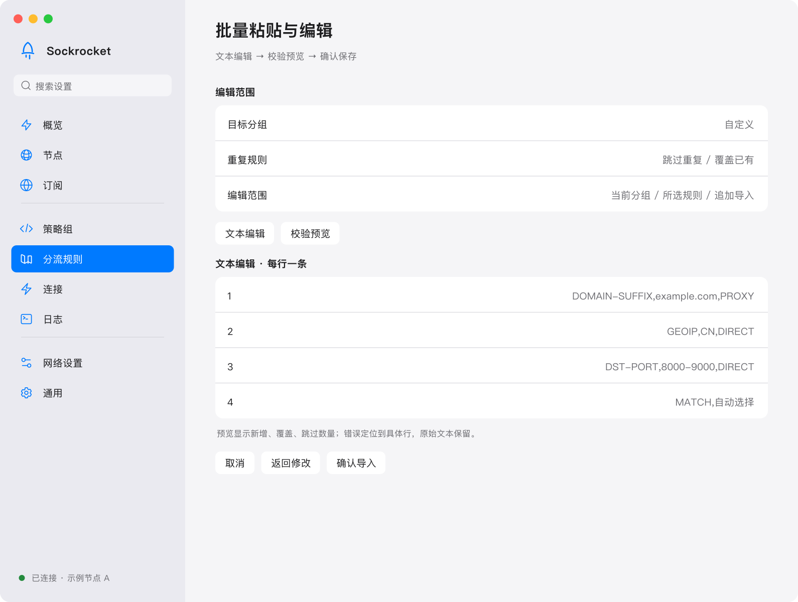

# Sockrocket

<p align="center">
  
</p>

<p align="center"><strong>桌面到路由器，共用一个 Rust 代理内核。</strong></p>
<p align="center">原生桌面客户端 · 命令行 · AsusWRT-Merlin 插件</p>
<p align="center">
  <a href="README.md">English</a> · <a href="README.vi.md">Tiếng Việt</a> · <strong>中文</strong>
</p>
<p align="center">
  <a href="https://github.com/sockrockets/sockrocket/releases/latest">下载最新版</a> ·
  <a href="docs/getting-started.md">使用指南</a> ·
  <a href="docs/merlin.md">Merlin 路由器</a> ·
  <a href="https://github.com/sockrockets/sockrocket/issues">反馈问题</a>
</p>

Sockrocket 将节点、订阅、分流规则和流量接管放在同一个客户端中。桌面端采用 macOS 系统设置风格的分组界面；CLI 和 Merlin 插件复用同一套协议与路由能力。

> **配图说明**：以下为依据项目 Figma 设计方向整理的界面示意，并非当前发行版逐像素截图。节点、订阅、流量和延迟均为虚构示例，部分布局与交互以实际版本为准。配图不包含真实服务器、订阅地址、令牌或个人节点信息。



## 主要能力

| 能力 | 用途 |
| --- | --- |
| 六种代理协议 | Shadowsocks、VMess、VLESS、Trojan、TUIC、Hysteria2 |
| 节点与订阅 | 导入节点链接或 Clash / V2Ray / sing-box 订阅，更新、搜索、去重与延迟测试 |
| 分流规则 | 规则、全局、直连模式；按域名、IP、GeoIP、端口选择出口 |
| 策略组 | 手动选择、URL 测速与故障切换 |
| 流量接管 | 系统代理适合常用应用；TUN 用于需要接管更多流量的场景 |
| 连接与日志 | 查看连接状态、流量统计和诊断信息 |
| 多端复用 | 桌面 GUI、CLI 与 Merlin WebUI，共用 Rust 内核 |
| 多语言 | 中文、English、Tiếng Việt |

协议与传输组合存在能力边界：ShadowTLS 不提供 UDP，VMess 原生 UDP 有单包大小限制。详见[协议说明](docs/protocols.md)。软件不提供代理节点或订阅服务。

## 下载与第一次连接

从 [GitHub Releases](https://github.com/sockrockets/sockrocket/releases/latest) 下载适合系统和架构的文件。

| 系统 | 桌面安装包 |
| --- | --- |
| macOS · Apple Silicon | `sockrocket-macos-aarch64.dmg` |
| macOS · Intel | `sockrocket-macos-x86_64.dmg` |
| Windows · x86_64 | `sockrocket-windows-x86_64.zip` |
| Linux · x86_64 | `sockrocket-linux-x86_64.tar.gz` |
| Linux · ARM64 | `sockrocket-linux-aarch64.tar.gz` |

1. 安装并打开客户端。macOS 将应用拖入「应用程序」后运行；Windows 解压后运行；Linux 解压后按包内说明安装或启动。
2. 在「订阅」中添加你自己的订阅，或在「节点」中导入节点链接。
3. 更新订阅，选择节点；可先执行延迟测试。
4. 在「概览」点击连接，等待连通性验证结果，再确认系统代理状态。
5. 确有全流量接管需求时再开启 TUN，并完成系统要求的管理员授权。

升级时先退出旧版本及其管理员后台实例。两个版本同时运行会争用监听端口，也可能重复接管 TUN 路由。

### 节点与订阅，分开管理

订阅管理来源，节点决定当前出口。延迟测试通过代理执行；毫秒数表示测试时的响应延迟，不代表下载带宽。



### 规则可以查看，也可以逐条修改

按匹配条件、出口与启用状态检查规则；需要调整时使用单条编辑、分组管理或匹配测试。规则顺序和优先级会影响最终路由。



### 多条规则，用文本批量处理

批量粘贴与分组编辑适合迁移已有规则。先检查解析结果、目标出口与冲突处理方式，再保存。示例域名使用保留的 `example.com`，不指向个人服务。



## 系统代理与 TUN 怎么选

| 方式 | 适用场景 | 注意事项 |
| --- | --- | --- |
| 系统代理 | 浏览器及遵循系统代理设置的应用 | 不保证所有应用都使用它 |
| TUN | 需要接管更多应用流量 | 需要管理员权限和可用的 TUN 环境；先关闭其他 TUN / VPN |
| CLI 本地监听 | 终端或手动配置代理的应用 | 默认仅监听本机；按需要配置调用方 |

默认本地端口：SOCKS5 `127.0.0.1:1080`，HTTP `127.0.0.1:1087`。这些是本机监听地址，不是远端节点。

## 命令行

CLI 文件与桌面安装包在同一发布页，名称以 `sockrocket-cli-` 开头。

```sh
sockrocket-cli --init config.yaml
# 在本机编辑配置，填入你自己的订阅或节点
sockrocket-cli config.yaml
```

用 `Ctrl+C` 停止。完整字段与安全示例见[配置参考](docs/configuration.md)。不要把填入真实凭据后的配置提交到仓库。

## AsusWRT-Merlin

路由器插件提供 WebUI、透明代理、DNS 接管和运行状态检查，让局域网设备共用代理内核。

1. 按固件平台和 CPU 架构选择 `sockrocket-merlin-<platform>.tar.gz`，不要仅根据机型名称猜测。
2. 按[Merlin 安装指南](docs/merlin.md)配置 JFFS 与自定义脚本，并安装对应软件包。
3. 在路由器本机页面配置订阅，先验证节点可用，再开启所需的 DNS / 透明代理功能。
4. 更新前备份配置；确认手动停止与网络恢复正常后再投入使用。

```sh
/jffs/addons/sockrocket/scripts/sockrocket.sh status
/jffs/addons/sockrocket/scripts/sockrocket.sh stop
/jffs/addons/sockrocket/scripts/sockrocket.sh start
```

平台差异、服务控制与故障恢复见 [Merlin 指南](docs/merlin.md)和[技术参考](docs/merlin-reference.md)。

## 常见问题

| 现象 | 先检查 |
| --- | --- |
| 点击连接后启动失败 | 是否有旧版后台进程；本地端口是否被占用；查看日志中的错误 |
| TUN 无法开启 | 管理员授权、驱动环境，以及是否已有其他 TUN 占用默认路由 |
| 显示已连接但网页打不开 | 分别检查节点连通性、系统代理 / TUN、DNS 与路由规则 |
| 订阅失败或没有节点 | 在本机核对地址、格式、服务器响应与解析结果 |
| 只有部分网站不可达 | 检查命中的规则、直连出口及 DNS，避免多个客户端同时接管 |

## 隐私与反馈

文档配图只使用虚构数据。提交 Issue、日志或截图前，请移除订阅完整 URL、查询参数、节点地址、密码、UUID、令牌、二维码、个人路径和账户信息。二维码与分享链接也可能包含完整凭据。

- [Issues](https://github.com/sockrockets/sockrocket/issues)：报告缺陷。
- [Discussions](https://github.com/sockrockets/sockrocket/discussions)：使用讨论。
- [文档目录](docs/README.md)：配置、协议、架构和开发说明。

## 许可

[Apache License 2.0](LICENSE)。本项目关于 AI / ML 训练使用的声明见 [ai.txt](ai.txt)、[robots.txt](robots.txt)和 [TDM 声明](.well-known/tdmrep.json)。
